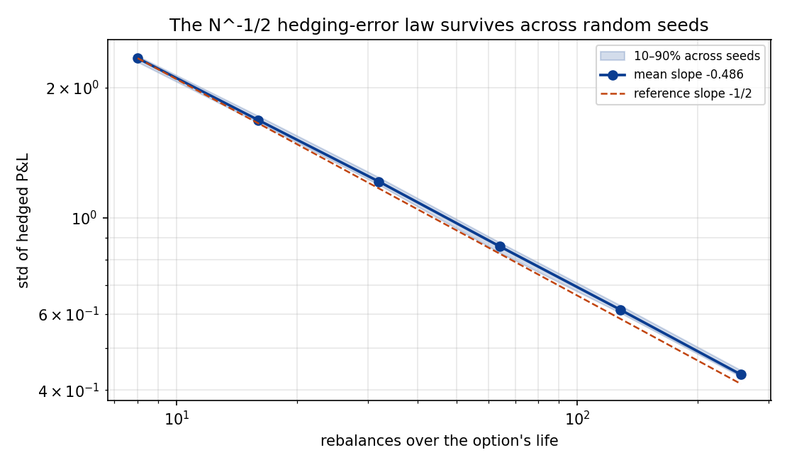
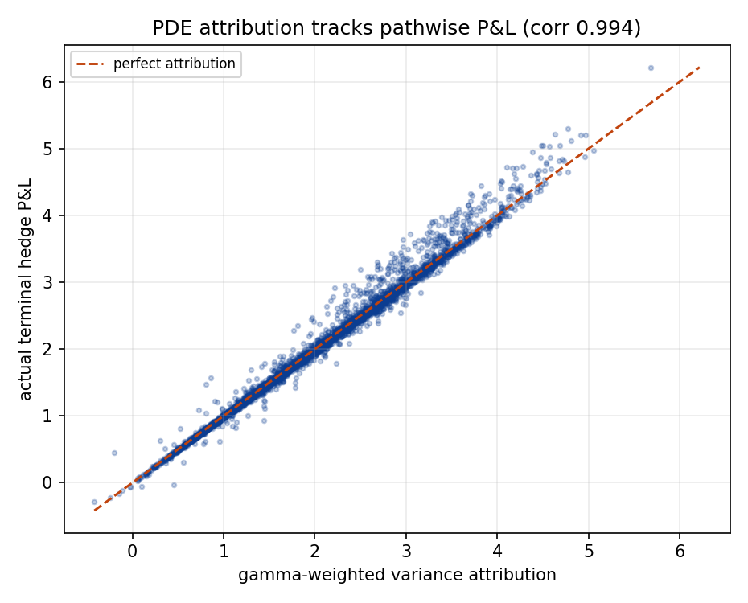
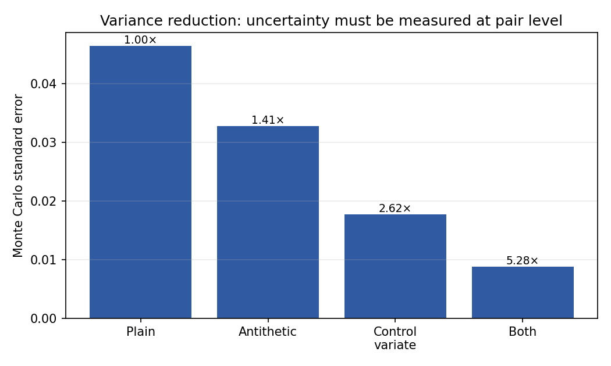
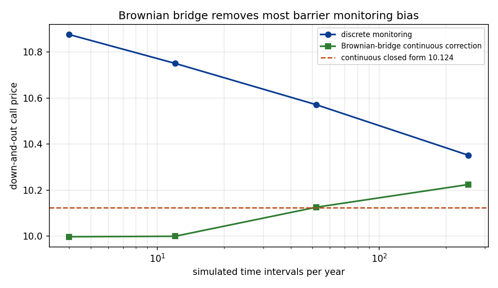
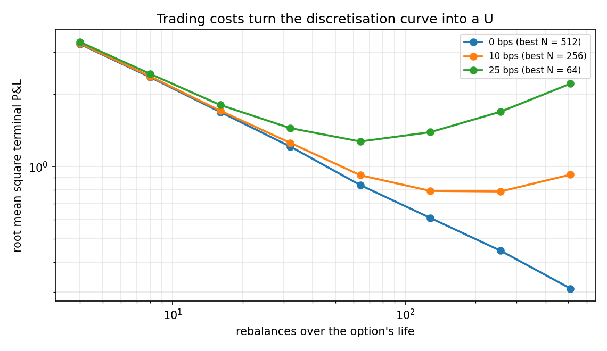
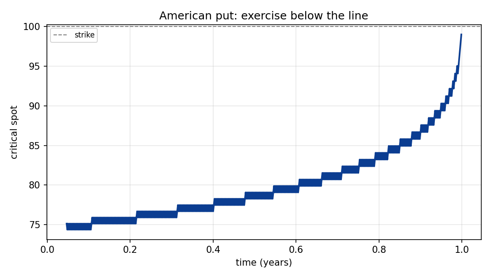
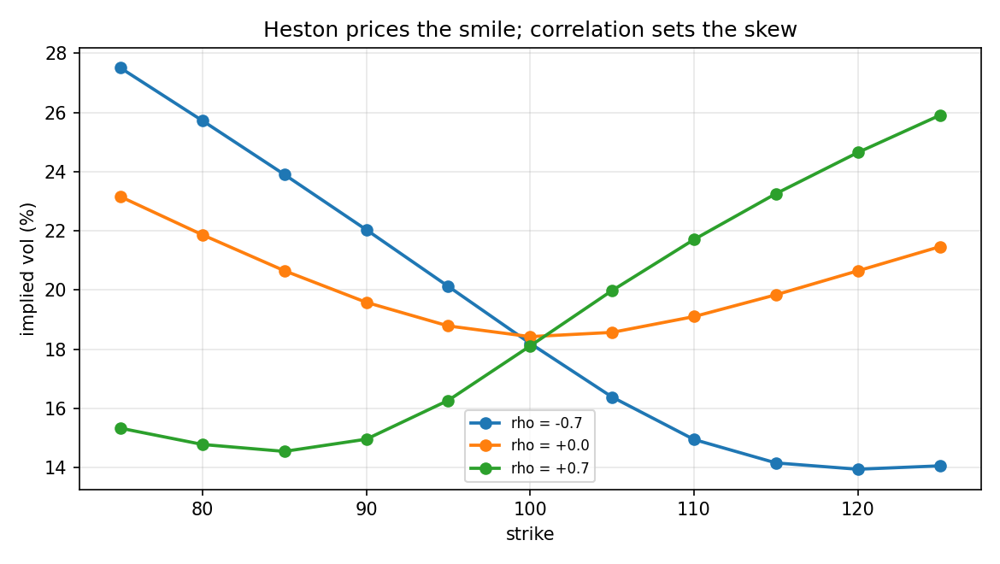
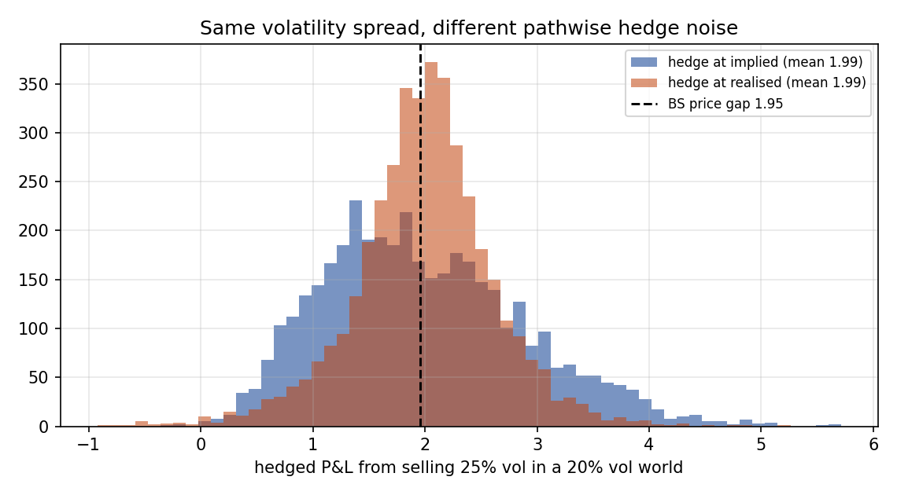

# Options Pricing, Hedging and Monte Carlo Laboratory

[](https://github.com/AhmadEblagh205/options-hedging-lab/actions/workflows/ci.yml)


An independent derivatives laboratory built around a simple rule: **when a closed-form or known-truth benchmark exists, numerical code should have to earn the right to be trusted.** The repository links Black-Scholes, CRR trees, Monte Carlo, implied volatility, American exercise, exotic options, Heston stochastic volatility and discrete delta hedging through tests and controlled simulations.

This is a simulation/methodology project. It uses **no live option-market data and reports no investment track record**.

## Results I would actually defend in an interview

### 1. The `N^-1/2` hedging-error law is robust, not a lucky seed

For frictionless discrete delta hedging, the log-log slope of P&L standard deviation against the number of rebalances should approach `-1/2`.

The original one-seed result was about `-0.48`. The v2 audit repeats the fit across 20 seeds:

- mean slope: **-0.4858**;
- empirical 2.5%-97.5% range: **[-0.4931, -0.4778]**.

So the public `-0.48 vs -0.50 theoretical` result survives a much stronger robustness check.



### 2. A hedged option is better understood through gamma-weighted variance

A simple regression of hedged P&L on realised variance gives correlation around `-0.81`, but that throws away the fact that gamma changes with spot and time.

The stronger PDE attribution accumulates

`0.5 * Gamma * S^2 * (implied variance - realised quadratic variation)`

through the path. With 128 hedge intervals:

- actual-vs-attributed P&L correlation: **0.9941**;
- attribution RMSE: **0.101**;
- mean actual P&L: **1.983**;
- mean attributed P&L: **1.981**.

At 512 intervals the pathwise correlation rises to about **0.9987**. This is the cleanest bridge in the repository between the Black-Scholes PDE and the economics of delta-hedged option P&L.



### 3. I found and fixed an antithetic-variance measurement bug

The original implementation generated antithetic paths correctly but computed their standard error as if the `z` and `-z` payoffs were independent. They are deliberately correlated, so the independent sampling unit is the **pair average**.

After correcting the uncertainty calculation, equal-trajectory benchmarks across ten random seeds show mean standard-error reductions of approximately:

- antithetic only: **1.42x**;
- terminal-stock control variate: **2.63x**;
- antithetic + control variate: **5.38x**.

So the old claim that antithetics “do essentially nothing” is retired; it was an artefact of the wrong standard-error calculation.



### 4. Barrier bias can be corrected without brute-force time stepping

A discretely monitored down-and-out simulation misses barrier crossings between dates and therefore prices above the continuously monitored contract.

V2 adds a **Brownian-bridge survival correction**. At 52 simulated intervals in the default experiment:

- continuous closed form: **10.1239**;
- naive discrete Monte Carlo: **10.5713**;
- Brownian-bridge estimate: **10.1258**.

The exact Monte Carlo value varies with seed; the important result is structural: conditional crossing probabilities remove most monitoring-grid bias under GBM.



### 5. Trading costs create an interior hedge frequency

With no trading cost, finer rebalancing reduces discretisation risk. Once a proportional fee is paid on every hedge trade, terminal-P&L RMSE becomes U-shaped.

In the default parameterisation:

- **0 bps:** best grid is the finest tested, 512 rebalances;
- **10 bps:** 256 is best in 10/12 random seeds and 128 in 2/12;
- **25 bps:** 64 is best in 12/12 seeds.

Those are controlled-model results, not execution recommendations.



## The validation stack

### Black-Scholes and Greeks

Closed-form prices and Greeks are cross-checked against finite differences. Put-call parity is held below `1e-10`, and the full Black-Scholes PDE residual is below roughly **4.3e-15** across the test grid.

### CRR trees and American exercise

European CRR prices converge to Black-Scholes. Backward induction then adds what the European closed form cannot: early exercise. The tests cover positive early-exercise premium for an in-the-money American put, zero premium for a non-dividend American call, dividend-driven call exercise, and the qualitative shape of the American-put exercise boundary.



### Asian options

The arithmetic Asian call uses its discretely monitored geometric sibling as a control variate. In the default experiment the standard error falls by about **29.8x** while the price remains statistically consistent with the plain simulation.

### Implied volatility

The Black-Scholes inversion is bracketed and checks European no-arbitrage bounds before solving. Impossible prices now fail loudly rather than returning a misleading endpoint. A two-regime controlled world generates a smile because the return distribution is not Black-Scholes lognormal.

### Heston stochastic volatility

A characteristic-function price is checked against full-truncation Euler Monte Carlo and against the Black-Scholes limit as vol-of-vol approaches zero. Correlation controls skew in the synthetic smile.

The demonstration parameters have Feller ratio `2*kappa*theta/xi^2 = 0.444`, so the sufficient Feller condition is not met; handling the variance boundary in simulation therefore matters rather than being decorative.



## Volatility mismatch and drift

Selling at 25% implied volatility in a world realising 20% gives a Black-Scholes price gap of about **1.9545**. With 128 hedges, the mean simulated P&L is about **1.99** whether delta is computed using realised or implied volatility, although the implied-vol hedge has materially more pathwise dispersion.

When sale, realised and hedge volatility all agree, changing physical drift from `-10%` to `+20%` has little effect on mean hedge P&L relative to sampling/discretisation noise. Directional exposure has largely been hedged away; the remaining experiment is principally about volatility and discretisation.



## Repository map

- `src/black_scholes.py` — European prices and Greeks
- `src/binomial.py` — CRR pricing and American exercise
- `src/monte_carlo.py` — MC pricing, antithetics, control variates
- `src/implied_vol.py` — bounded implied-volatility inversion and mixture smile
- `src/hedging.py` — discrete hedge simulator, trading costs and robustness study
- `src/exotics.py` — Asian options and barrier/Brownian-bridge experiment
- `src/heston.py` — semi-closed Heston pricing and full-truncation MC
- `src/attribution.py` — PDE identity and gamma-weighted P&L attribution
- `docs/METHODOLOGY.md` — equations, assumptions and claim boundaries
- `tests/` — analytical, numerical and defensibility regressions

## Reproduce

```bash
pip install -r requirements.txt
pytest -q
python src/monte_carlo.py
python src/hedging.py
python src/exotics.py
python src/heston.py
python src/attribution.py
python src/boundary_figure.py
```

The current suite contains **23 passing tests**.

## Licence

MIT, see [LICENSE](LICENSE).
